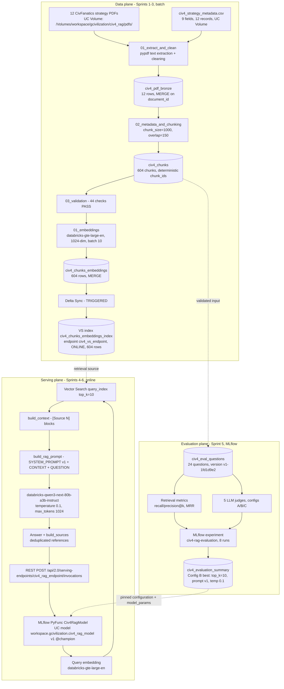

# Civilization IV Strategy RAG Assistant

An end-to-end **Retrieval-Augmented Generation (RAG)** assistant that answers questions about *Civilization IV* strategy from a curated corpus of 12 community strategy guides — built and deployed entirely on **Databricks (Free Edition)**, from PDF ingestion to a live, evaluated REST inference endpoint.

This is a portfolio project demonstrating practical AI engineering: document processing, chunking, embeddings, Databricks Vector Search, prompt engineering, LLM evaluation with MLflow judges, experiment tracking, model registration in Unity Catalog, and production-style Model Serving with secret-based credentials — all inside the constraints of the free tier.

---

## Table of Contents

1. [Project Overview](#project-overview)
2. [Objectives](#project-objectives)
3. [Key Features](#key-features)
4. [Technology Stack](#technology-stack)
5. [System Architecture](#system-architecture)
6. [Project Workflow (Sprints)](#project-workflow-sprints-1-7)
7. [Repository Structure](#repository-structure)
8. [Data Sources](#data-sources)
9. [RAG Pipeline](#rag-pipeline)
10. [Evaluation](#evaluation)
11. [Model Serving](#model-serving)
12. [Installation and Setup](#installation-and-setup)
13. [Usage](#usage)
14. [Limitations](#limitations)
15. [Future Improvements](#future-improvements)
16. [Project Development](#project-development)
17. [License](#license)
18. [Acknowledgments and References](#acknowledgments-and-references)

---

## Project Overview

*Civilization IV* strategy knowledge is scattered across long, fan-written guides on civfanatics.com. This project turns 12 of those guides (≈573k characters) into a **grounded question-answering service**: ask a strategy question in plain English, get an answer that is (a) generated only from retrieved guide passages, (b) explicitly cited with `[Source N]` labels, and (c) returned with structured document references including title, author, and source URL. If the retrieved context is insufficient, the assistant says so instead of fabricating an answer.

The full lifecycle is implemented and measured, not just prototyped: an idempotent ingestion→chunking pipeline, a validated retrieval layer, a systematically **evaluated** generation layer (24-question benchmark, retrieval metrics, 5 LLM judges, 3 config A/B/C comparison), and a **deployed** model behind a REST endpoint with 10/10 passing end-to-end tests.

## Project Objectives

* Build a complete, production-oriented RAG system — not a notebook demo — on a single managed platform.
* Demonstrate the full MLOps/LLMOps loop for GenAI: **process → retrieve → generate → evaluate → track → register → deploy → test**.
* Ground every quality claim in measured evidence (MLflow-tracked runs, persisted metrics) rather than subjective impressions.
* Stay strictly within Databricks Free Edition capabilities — no paid external services.
* Produce a clean, documented, reproducible public repository.

## Key Features

* **Document processing** — pypdf extraction with per-document diagnostics, metadata enrichment (title, author, category, game version, expansion, source URL, date), 1000-char chunks with 150 overlap and deterministic chunk IDs, MERGE/overwrite idempotency, and a 44-check validation gate.
* **Semantic retrieval** — `databricks-gte-large-en` 1024-dim embeddings (batch size 10 — the serverless cap), Databricks Vector Search Delta Sync index (self-managed embeddings, TRIGGERED sync), 604 chunks / 12 documents indexed.
* **Grounded generation** — anti-hallucination system prompt, `[Source N]` citation contract, insufficient-context refusal, deduplicated references with chunk-level traceability, `databricks-qwen3-next-80b-a3b-instruct` at temperature 0.1.
* **Systematic evaluation** — 24-question benchmark (2 per document, 9 categories, 3 difficulties, versioned dataset), recall/precision@K + MRR retrieval metrics, 5 LLM-judge generation metrics, A/B/C configuration comparison pinned to evidence.
* **MLflow tracking & UC registration** — dedicated experiments with params/metrics/artifacts; MLflow PyFunc model registered in Unity Catalog with lineage tags from eval run to endpoint.
* **Model Serving** — `civ4_rag_endpoint` (serverless CPU, scale-to-zero, secret-backed token env var) with a declared input/output signature and a 10-scenario test suite incl. failure modes.

## Technology Stack

| Layer | Technology |
| --- | --- |
| Platform | Databricks Free Edition (serverless compute, Unity Catalog) |
| Language | Python 3 (Databricks notebooks) |
| Storage | Delta Lake tables in UC schema `workspace.gcivilization`, UC Volume for source files |
| PDF processing | pypdf |
| Embeddings | `databricks-gte-large-en` (Foundation Model API, 1024-dim) |
| Vector store | Databricks Vector Search (STANDARD endpoint, Delta Sync index) |
| Generation LLM | `databricks-qwen3-next-80b-a3b-instruct` (Foundation Model API) |
| Evaluation | MLflow genai judges + custom judges; retrieval metrics |
| Tracking / registry | MLflow experiments + Unity Catalog Model Registry (`databricks-uc`) |
| Serving | Databricks Model Serving (MLflow PyFunc, serverless CPU Small) |
| SDK | `databricks-sdk` (WorkspaceClient), `mlflow` / `mlflow.deployments` |
| Dependencies | See [`requirements.txt`](requirements.txt) (mlflow ≥ 3.0, databricks-sdk ≥ 0.122.0, pandas ≥ 2.0, pypdf) |

## System Architecture

Three planes: **batch data** (Sprints 1–3), **evaluation** (Sprint 5), and **online serving** (Sprints 4 & 6). Full details in [`docs/architecture.md`](docs/architecture.md); diagrams in [`docs/diagrams/`](docs/diagrams/).



## Project Workflow (Sprints 1–7)

| Sprint | Focus | Outcome |
| --- | --- | --- |
| 1 | Scope, document collection, metadata design | 12 PDFs + 9-field metadata CSV in a UC Volume (data lives outside the repo for copyright reasons) |
| 2 | Processing pipeline (`02_processing/`) | `civ4_pdf_bronze` (12) → `civ4_chunks` (604) with 44/44 validation checks |
| 3 | Retrieval (`03_retrieval/`) | Embeddings (604), VS endpoint + Delta Sync index, `retrieve()` function, 19/19 checks |
| 4 | RAG generation (`04_generation/`) | Shared `rag_utils.py` pipeline, cited answers, OOD refusal, 36/36 checks |
| 5 | Evaluation (`05_evaluation/`) | 24-question benchmark, retrieval + 5-judge metrics, A/B/C configs, MLflow tracking, idempotent persistence |
| 6 | Model serving (`06_model_serving/`) | PyFunc packaging → UC registration v1 `@champion` → `civ4_rag_endpoint` READY → 10/10 inference tests |
| 7 | Portfolio & documentation (`docs/`) | Architecture, technical decisions, evaluation report, audit, this README |

## Repository Structure

```text
civ4-rag/
├── README.md                    # This file
├── LICENSE                      # AGPL-3.0 (code)
├── .gitignore                   # Python artifacts + PDF exclusion guard
├── requirements.txt             # Verified third-party dependencies
├── docs/
│   ├── architecture.md          # End-to-end system architecture (verified)
│   ├── technical_decisions.md   # TD-001 … TD-017 with evidence markers
│   ├── evaluation_results.md    # Methodology + both recorded eval runs
│   ├── audit_report.md          # Sprint 1–6 audit + GitHub readiness checklist
│   └── diagrams/                # Mermaid sources for the 4 diagrams
├── 02_processing/               # Sprint 2: extraction → chunking → validation
│   ├── 01_extract_and_clean.py
│   ├── 02_metadata_and_chunking.py
│   └── 03_validation.py
├── 03_retrieval/                # Sprint 3: embeddings → vector search → retrieval
│   ├── 01_embeddings.py
│   ├── 02_vector_search.py
│   ├── 03_retrieval.py
│   └── 04_validation.py
├── 04_generation/               # Sprint 4: RAG pipeline + validation
│   ├── rag_utils.py             # Shared pipeline module (retrieval→prompt→generate→sources)
│   ├── 01_rag_pipeline.py
│   └── 02_validation.py
├── 05_evaluation/               # Sprint 5: eval dataset → metrics → judges → MLflow
│   ├── rag_eval_utils.py       # Shared eval module
│   ├── 01_eval_dataset.py … 05_validation.py
│   └── README.md                # Methodology + recorded results
└── 06_model_serving/            # Sprint 6: packaging → registration → deployment → tests
    ├── rag_model.py            # Civ4RagModel (MLflow PyFunc) + pinned config
    ├── 01_model_packaging.ipynb
    ├── 02_model_registration.ipynb
    ├── 03_model_serving_deployment.ipynb
    ├── 04_inference_testing.ipynb
    └── README.md                # Deployment docs + full REST API reference
```

Each numbered folder is a sprint and an execution stage; notebooks run in numeric order within a folder and folders run 02 → 06. There is no `01_ingestion/` folder: Sprint 1's artifacts are the source documents themselves, stored in a Databricks UC Volume and deliberately **not** committed (see Data Sources).

## Data Sources

The knowledge base is a curated set of **12 Civilization IV strategy guides originally published on [civfanatics.com](https://civfanatics.com/civ4/strategy/)**, by their original authors (WoundedKnight, Sisiutil, JackOfClubs, OTAKUjbski, Arathorn, Requies, Wejer, dankok8, spiceant, Bismarck, Agerz). Topics span beginner guides, empire management, game mechanics, military strategy, civilization-specific play, and victory conditions (Vanilla → Beyond the Sword).

* **The PDFs are NOT redistributed in this repository.** Copyright in the guides belongs to their authors, and redistribution rights were not granted. Each notebook expects the documents at `/Volumes/workspace/gcivilization/civ4_rag/pdfs/` with a sidecar `civ4_strategy_metadata.csv` (document_id, title, author, category, game_version, expansion, source_url, publication_date) that carries full attribution and the original civfanatics.com URLs.
* **To reproduce:** download the guides from the source URLs listed in the metadata (see `docs/architecture.md` §2 for the schema) and upload them plus the CSV to the volume path above. `civ4_strategy_metadata.csv` is intentionally not committed either, to keep document records together with the documents themselves; its exact schema and field contents are documented in `docs/architecture.md`.
* All answers served by the assistant cite the original author, title, and source URL.

## RAG Pipeline

1. **Processing (Sprint 2):** pypdf extracts and cleans text per PDF with per-document diagnostics (`extraction_status`, `page_count`, `character_count`) → MERGE into `civ4_pdf_bronze` on `document_id`. Metadata is validated 1:1 against files, joined, and text is split into 1000-char chunks (150 overlap) with deterministic IDs `{document_id}_chunk_{index:04d}` → `civ4_chunks` (604 chunks). A 44-check validation gate must pass before anything downstream runs.
2. **Embeddings & Vector Search (Sprint 3):** every chunk is embedded with `databricks-gte-large-en` (1024-dim, batch size 10 — serverless limit) and MERGEd into `civ4_chunks_embeddings`. A Delta Sync index (`civ4_chunks_embeddings_index` on endpoint `civ4_vs_endpoint`) syncs chunk text, 9 metadata columns, and vectors — self-managed embeddings, TRIGGERED sync.
3. **Generation (Sprint 4, `rag_utils.py`):** `rag_query()` embeds the question → retrieves top-k chunks → formats each as an attributed `[Source N]` block → builds the system prompt (answer only from context; no invented facts; refuse when insufficient; cite `[Source N]`; no fabricated citations) + user prompt → generates with `databricks-qwen3-next-80b-a3b-instruct` (temperature 0.1, max_tokens 1024) → returns answer plus references deduplicated by document (chunk IDs + scores retained internally).

## Evaluation

Full methodology, both recorded runs, and MLflow references: [`docs/evaluation_results.md`](docs/evaluation_results.md). Verified headline results (24 questions, dataset version `v1-1fd1d9e2`):

* **Retrieval:** Recall@1 **0.875** · Recall@5 **1.000** · MRR **0.927** · Precision@5 0.633 · Precision@10 0.558
* **Generation (Config B, deployed):** faithfulness **1.000** · citation_correctness **0.917** · answer_correctness **0.667** (2026-11-02 run; 0.583 on the initial 2026-11-01 run)
* **Config comparison:** top_k=10 beat the top_k=5 baseline on citations and answer correctness; a concise-bullets prompt variant (v2) degraded every judge dimension and was rejected. The best config was **pinned** into the deployed model.
* Every run is tracked in MLflow experiment `civ4-rag-evaluation`; every eval row carries `mlflow_run_id` + dataset version for traceability. Limitations (small n, document-level ground truth, judge nondeterminism, binary judges) are documented honestly in the evaluation report.

## Model Serving

The pipeline is deployed as an MLflow **PyFunc** model (`Civ4RagModel`, `06_model_serving/rag_model.py`) that ships the Sprint 4 pipeline verbatim via `code_paths` — zero duplicated business logic — with a declared signature (`question: string` → `answer: string` + references array) and the pinned best-evaluated config (top_k=10, prompt v1, temperature 0.1).

* **Registered model:** `workspace.gcivilization.civ4_rag_model` **version 1**, alias **`@champion`**, in Unity Catalog. Version tags link it to its MLflow run and the winning eval run (`92a0225f…`, dataset `v1-1fd1d9e2`) — full data→eval→model→endpoint lineage.
* **Endpoint:** `civ4_rag_endpoint` — serverless CPU Small, scale-to-zero, **READY** (verified 2026-11-06). Outbound auth (Vector Search + Foundation Model APIs) uses `DATABRICKS_HOST` and a secret-backed `DATABRICKS_TOKEN` env var; the token value is never printed or logged. It is a 30-day PAT that must be rotated by re-running notebook 03.
* **Interface:** `POST /api/2.0/serving-endpoints/civ4_rag_endpoint/invocations` with `{"dataframe_records": [{"question": "…"}]}`; returns `{"predictions": [{"answer": "…", "references": [{document_id, title, source_url, author, category}]}]}`. Full request/response docs, curl + SDK examples, and error behavior: [`06_model_serving/README.md`](06_model_serving/README.md).
* **Verified by a 10-scenario test suite** (2026-11-06, 10/10 PASS): live questions via SDK and raw REST, retrieval parity with the validated pipeline, empty-question structured response, schema-enforced rejection of malformed payloads, simulated Vector Search/LLM outages with informative errors (no secret leakage), endpoint availability.

## Installation and Setup

**Prerequisites**

* A Databricks workspace with **serverless compute** (this project was built on **Free Edition**), Unity Catalog, Foundation Model APIs (`databricks-gte-large-en`, `databricks-qwen3-next-80b-a3b-instruct`), Vector Search, and Model Serving enabled.
* Permission to create a UC catalog/schema (the project uses `workspace.gcivilization`), volumes, tables, a secret scope, and serving endpoints.
* Python 3 on serverless compute. Dependencies: `pip install pypdf` per session (`pypdf` is not preinstalled on Free Edition serverless); `mlflow`, `databricks-sdk`, `pandas` are provided by the runtime — see [`requirements.txt`](requirements.txt).

**Steps**

1. Clone the repo and add it to your Databricks workspace as a Git folder.
2. Create the volume structure and upload the 12 source PDFs + `civ4_strategy_metadata.csv` to `/Volumes/workspace/gcivilization/civ4_rag/` (see [Data Sources](#data-sources) — documents must be fetched from civfanatics.com).
3. Run the notebooks in order: `02_processing/01→03` → `03_retrieval/01→04` → `04_generation/01→02` → `05_evaluation/01→05` → `06_model_serving/01→04`. Each folder's validation notebook gates the next stage.
4. For the serving deployment (Sprint 6): create secret scope `civ4_rag_serving` and follow `06_model_serving/README.md` (notebook 03 mints the PAT and stores it as a secret automatically, with your approval).

**Notes**

* Notebooks reference shared modules (`rag_utils`, `rag_eval_utils`, `rag_model`) via `sys.path` insertion of their folder — `%run` does not work for this pattern on repo notebooks in this workspace.
* Names of tables, endpoints, and the index are fixed in the modules (e.g., `INDEX_NAME` in `rag_utils.py`); adjust the constants to use a different catalog/schema.

## Usage

* **In notebooks:** import `rag_utils` (Sprint 4) and call `rag_utils.rag_query("How should I use the Great Library?", top_k=10)` → `{query, answer, sources, retrieved_chunks}`.
* **Via the deployed endpoint:**

```python
from databricks.sdk import WorkspaceClient
w = WorkspaceClient()
resp = w.serving_endpoints.query(
    name="civ4_rag_endpoint",
    dataframe_records=[{"question": "What should a new player focus on first?"}],
)
print(resp.predictions[0])  # {answer: "...", references: [{...}]}
```

Or via REST (`POST /api/2.0/serving-endpoints/civ4_rag_endpoint/invocations`, Bearer auth) — full curl example in [`06_model_serving/README.md`](06_model_serving/README.md).

* **Out-of-scope questions** (e.g., about other games or modern events) get an explicit "insufficient context" refusal rather than a fabricated answer.

## Limitations

* **Platform (Databricks Free Edition):** CPU-only Model Serving with capped endpoint count, no GPU/provisioned throughput; embedding batches capped at 10; ~7–8 min Vector Search provisioning; 1–2 min serving cold start after idle; a 30-day serving PAT requiring monthly rotation.
* **Data coverage:** 12 guides (604 chunks) covering Vanilla → Beyond the Sword; questions outside the corpus are refused, not answered.
* **Retrieval:** single-stage dense retrieval; no hybrid BM25, reranker, or filters; document-level ground truth makes precision@K a lower bound.
* **Generation:** judge-measured answer_correctness of 0.54–0.67 shows factual-coverage headroom; answer text is not byte-reproducible at temperature 0.1 (retrieval is deterministic).
* **Evaluation:** 24 questions → directional evidence, not statistical proof; LLM judges are nondeterministic (config differences < ~0.1 not conclusive); judges are binary.
* **Licensing of content:** the assistant serves content authored by civfanatics.com writers; this repository distributes only code and attribution, not the documents (see [License](#license)).

## Future Improvements

*(Ideas only — none of these are implemented.)*

* Hybrid BM25 + dense retrieval and/or a cross-encoder reranker (recall is already 1.000@5; gains would be in precision/ranking).
* Larger evaluation set (50–100 questions) with chunk-level ground truth and repeated-run variance reporting.
* Query-rewrite / multi-turn conversation support; streaming responses.
* Corpus growth: re-run the Sprint 3 sync pipeline and register a new model version (notebooks are idempotent for this).
* CI: schedule the Sprint 5 validation notebook as a recurring job; alert on endpoint drift.

## Project Development

Seven incremental sprints, each with a validation gate:

1. **Sprint 1 — Setup / data preparation.** Scope, document collection (12 PDFs), metadata design (9 fields). Data-only; no code in the repo.
2. **Sprint 2 — Processing.** Extraction (pypdf) → bronze table → metadata + chunking (1000/150, deterministic IDs) → 44-check validation. `civ4_chunks`: 604 chunks.
3. **Sprint 3 — Retrieval.** Embeddings (`databricks-gte-large-en`), Vector Search endpoint + Delta Sync index (self-managed embeddings), `retrieve()` API, 19/19 checks.
4. **Sprint 4 — Generation.** Shared `rag_utils.py` RAG pipeline with anti-hallucination prompt and cited references; OOD refusal verified; 36/36 checks.
5. **Sprint 5 — Evaluation.** 24-question benchmark; retrieval metrics; 5 LLM judges; A/B/C config comparison; MLflow experiment tracking; idempotent Delta persistence.
6. **Sprint 6 — Model serving.** PyFunc packaging → UC registration (`civ4_rag_model` v1 `@champion`) → endpoint `civ4_rag_endpoint` (secret-backed credentials) → 10/10 inference tests.
7. **Sprint 7 — Portfolio / documentation.** Full technical audit, architecture + decision + evaluation documents, diagrams, this README, dependency and readiness checks.

## License

The **code in this repository is licensed under the GNU Affero General Public License v3.0 (AGPL-3.0)** — see [`LICENSE`](LICENSE). AGPL is a strong copyleft license: you may use, study, modify, and commercially use the code, but any distribution — including running a modified version as a network service — requires offering the corresponding source to those users. This choice deliberately discourages proprietary, closed-source reuse of this project.

**Not covered by the license:** the 12 Civilization IV strategy guides are copyrighted works of their civfanatics.com authors and are **not** redistributed here (see [Data Sources](#data-sources)). Answers produced by the deployed assistant derive from those works and cite them.

## Acknowledgments and References

* **[CivFanatics](https://civfanatics.com/)** and the guide authors — WoundedKnight, Sisiutil, JackOfClubs, OTAKUjbski, Arathorn, Requies, Wejer, dankok8, spiceant, Bismarck, Agerz — for two decades of community strategy writing. This project is a tribute to that work; please read the originals at the URLs recorded in the project metadata.
* **[Databricks](https://www.databricks.com/)** — Free Edition, Delta Lake, Unity Catalog, Vector Search, Foundation Model APIs, MLflow, and Model Serving.
* **Sid Meier's Civilization IV** (Firaxis Games / 2K) — the game this knowledge base is about. This is an unofficial fan project, not affiliated with or endorsed by Firaxis or 2K.
