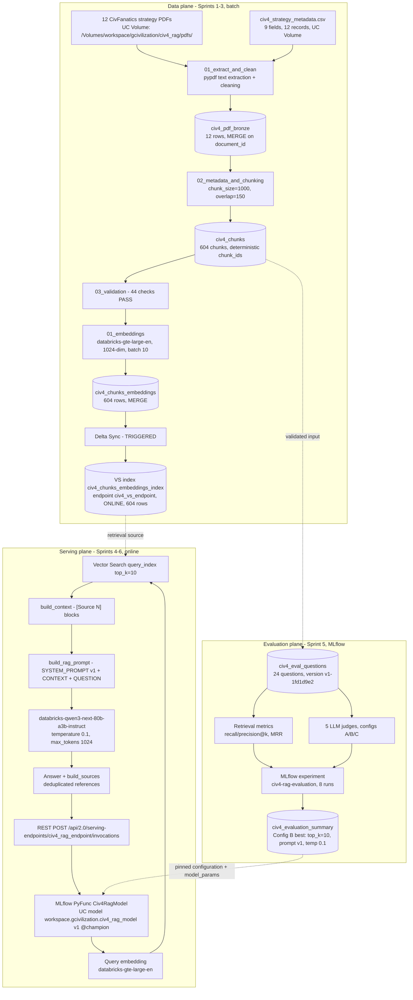
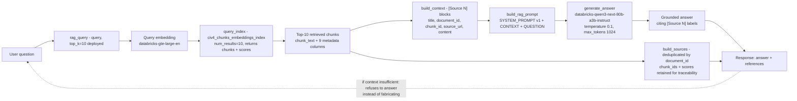

# System Architecture — Civilization IV Strategy RAG Assistant

**Status:** COMPLETE (Sprint 7, 2026-11-06). This document describes the *actual* implemented system, verified against the workspace artifacts (tables, Vector Search endpoint/index, MLflow runs, registered model, and serving endpoint) on 2026-11-06. Every table name, model name, and configuration value below was read from the live system.

> **Environment:** Databricks Free Edition. All components stay within Free Edition capabilities (serverless compute, CPU-only Model Serving, Foundation Model APIs, Unity Catalog). See `technical_decisions.md` (TD-015) for constraints.

---

## 1. High-Level Architecture

The system has three planes:

1. **Data plane (batch, Sprints 1–3).** 12 Civilization IV strategy PDFs (originally from civfanatics.com) plus a curated metadata CSV are stored in a Unity Catalog Volume. Text is extracted with `pypdf`, cleaned, enriched with metadata, and chunked into Delta Lake. Each chunk is embedded with `databricks-gte-large-en` (1024-dim) and the embeddings table is continuously synced into a Databricks Vector Search index.
2. **Evaluation plane (Sprint 5).** A 24-question evaluation set with document-level ground truth measures retrieval (recall@K, precision@K, MRR) and generation quality (5 LLM judges) across three pipeline configurations (A/B/C). Every run is tracked in MLflow; results persist to Delta and pin the deployed configuration.
3. **Serving plane (online, Sprints 4–6).** A user question is embedded, the top-k chunks retrieved via Vector Search, a grounded prompt is built, and an LLM generates an answer with `[Source N]` citations and structured document references. The pipeline is packaged as an MLflow PyFunc model, registered in Unity Catalog (`civ4_rag_model` v1, alias `@champion`), and deployed on Databricks Model Serving (`civ4_rag_endpoint`).

### Diagram A — End-to-End System Architecture

Source: [`diagrams/system_architecture.mmd`](diagrams/system_architecture.mmd)

### Request and data flow

* **Batch flow:** PDF + CSV → extraction/cleaning → bronze Delta table → chunking + metadata join → `civ4_chunks` → embedding generation → `civ4_chunks_embeddings` → Delta Sync → Vector Search index.
* **Online flow:** question → query embedding → Vector Search top-10 → context blocks `[Source N]` → system+user prompt → LLM → answer + deduplicated references → REST response.
* **Evaluation flow:** eval questions → retrieval metrics + 5-judge generation scores → MLflow runs → Delta summary → pinned Config B → model parameters on the deployed version.

---

## 2. Data Architecture

All Delta tables live in Unity Catalog schema `workspace.gcivilization`. Source documents live in the UC Volume `/Volumes/workspace/gcivilization/civ4_rag/` (12 PDFs under `pdfs/` plus `civ4_strategy_metadata.csv`). **The PDFs are not redistributed in this repository** (copyright belongs to the civfanatics.com authors; see the root README, §Data Sources).

### Metadata CSV (`civ4_strategy_metadata.csv`, 9 fields)

`document_id`, `pdf_filename`, `title`, `author`, `category`, `game_version`, `expansion`, `source_url`, `publication_date`. Categories: Beginner, Empire, Mechanics, Military, Civ-specific, Victory.

### Delta tables (7)

| Table | Rows | Role | Key columns | Write pattern
| --- | --- | --- | --- | --- |
| `civ4_pdf_bronze` | 12 | Raw extracted PDF text + metadata + extraction diagnostics (`extraction_status`, `page_count`, `character_count`, `extraction_error`, `metadata_match_status`) | `document_id` | MERGE (idempotent) |
| `civ4_chunks` | 604 | Validated chunk corpus. `chunk_id = {document_id}_chunk_{index:04d}`, chunk_size 1000, overlap 150. Avg 948 chars, min 192, max 999; 572,662 total characters. 14 columns: `document_id`, `chunk_id`, `pdf_filename`, `title`, `author`, `category`, `game_version`, `expansion`, `source_url`, `publication_date`, `chunk_index`, `chunk_text`, `chunk_character_count`, `chunking_timestamp` | `chunk_id` | Overwrite (deterministic chunk_ids) |
| `civ4_chunks_embeddings` | 604 | Chunks + embeddings. `embedding` (1024-dim ARRAY), `embedding_model`, `embedding_dimension`, `embedding_status` (all SUCCESS), `embedding_timestamp` | `chunk_id` | MERGE |
| `civ4_eval_questions` | 24 | Curated eval set: `question`, `expected_answer`, `expected_document_ids` (document-level ground truth), `expected_source_titles`, `category` (9 values), `difficulty` (easy/medium/hard), `eval_dataset_version` (`v1-1fd1d9e2`) | `question_id` | Overwrite |
| `civ4_retrieval_eval` | 24 | Per-question retrieval results: retrieved ids/chunks/scores, `recall_at_1/3/5/10`, `precision_at_5/10`, `mrr`, `first_relevant_rank` | `question_id` | Overwrite |
| `civ4_generation_eval` | 72 | Per-question generation results for 3 configs × 24 questions: `answer`, judge scores (`judge_faithfulness`, `judge_context_relevance`, `judge_answer_relevance`, `judge_citation_correctness`, `judge_answer_correctness`) + per-judge error columns, `top_k`, `prompt_version`, `temperature`, `mlflow_run_id` | (config, question) | MERGE (idempotent) |
| `civ4_evaluation_summary` | 3 | Aggregated metrics per config (A/B/C), incl. `judge_error_rate`, `eval_dataset_version`, `mlflow_run_id`, `eval_timestamp` | `config_name` | MERGE |

### Vector Search

* **Endpoint:** `civ4_vs_endpoint` — STANDARD tier, state ONLINE (verified).
* **Index:** `workspace.gcivilization.civ4_chunks_embeddings_index` — DELTA_SYNC index with **self-managed embeddings** (the `embedding` column is computed by the pipeline; the index does not call an embedding model), TRIGGERED pipeline, 604 indexed rows (verified). Synced columns: `chunk_id`, `chunk_text`, `document_id`, `title`, `author`, `category`, `game_version`, `expansion`, `source_url`, `publication_date` (+ the embedding vector).

### RAG input/output (Sprint 4 `rag_query`)

Input: `query: string`, `top_k: int` (default 5; deployed config pins 10). Output: `{query, answer, sources, retrieved_chunks}` — sources are deduplicated by `document_id` with chunk-level `{chunk_id, score}` traceability retained.

### Model Serving inference schema (declared MLflow signature)

Input: `question: string`. Output: `answer: string` + `references: array of {document_id, title, source_url, author, category}`. Requests use `dataframe_records`; multiple records answered in one request.

---

## 3. Model Architecture

Three distinct models must not be confused:

| Role | Model / artifact | Where it runs |
| --- | --- | --- |
| **Embedding model** | `databricks-gte-large-en` (Foundation Model API), 1024 dimensions, batch size 10 (serverless limit) | Batch indexing (Sprint 3) + per-query embedding at inference |
| **Generation LLM** | `databricks-qwen3-next-80b-a3b-instruct` (Foundation Model API), temperature 0.1, max_tokens 1024 | Chat completion per RAG query |
| **Registered inference model** | `workspace.gcivilization.civ4_rag_model` v1 — MLflow PyFunc `Civ4RagModel` that **orchestrates** the two models above + Vector Search | Databricks Model Serving, endpoint `civ4_rag_endpoint` |

### Retrieval strategy

Dense retrieval only (single-stage): query embedding → Vector Search `query_index` with `num_results=top_k`. Relevance scored by cosine similarity in the VS index. The deployed config uses `top_k=10`.

### Prompt architecture (prompt v1)

* **System prompt** (7 instructions): answer only from context; do not invent facts; if context is insufficient, say "I don't have enough information in the available context to fully answer this question" instead of fabricating; preserve Civ4 terminology; 3–6 paragraphs; cite `[Source N]` labels; never fabricate titles/URLs/citations.
* **User prompt:** `CONTEXT:` (one block per chunk: `[Source N]`, title, document_id, chunk_id, source_url, content) followed by `QUESTION:`.
* **Citation mechanism:** the model cites `[Source N]` labels; the API response additionally returns structured `references` (deduplicated source documents) built by `build_sources`.

### Evaluation approach (summary — details in `evaluation_results.md`)

24 curated questions (2 per source document, 9 categories, 3 difficulties), document-level ground truth. Retrieval: recall@K / precision@K / MRR. Generation: 5 MLflow genai LLM judges (binary, averaged). Configs A (top5/v1), B (top10/v1), C (top5/v2-bullets) compared; **Config B pinned** for deployment.

### MLflow integration

* **Experiment `/Users/endoerner@gmail.com/civ4-rag-evaluation`** (ID 2621923533772277): 8 runs — 2 retrieval runs + 6 full-pipeline runs (initial 2026-11-01 set A/B/C + idempotent 2026-11-02 rerun set). Params (top_k, prompt_version, temperature), metrics, and per-question answer artifacts recorded.
* **Experiment `/Users/endoerner@gmail.com/civ4-rag-model-serving`** (ID 481989999099671): run `f188f37b33954ca7819e16a2473f7432` logs the deployable PyFunc.

### Model packaging & serving

* **Packaging:** `Civ4RagModel` (MLflow `PythonModel`). The Sprint 4 pipeline `rag_utils.py` ships inside the artifact via `code_paths` — zero business-logic duplication. Pinned config: `B_top10_prompt_v1` (top_k=10, prompt v1, temperature 0.1, eval dataset `v1-1fd1d9e2`), stored as `model_params` on the registered version.
* **Registration:** Unity Catalog Model Registry — `civ4_rag_model` **version 1, status READY**, alias **`@champion`** (verified). Version tags link to MLflow run `f188f37b…` and eval run `92a0225f…` for full lineage: data → eval → model → endpoint.
* **Deployment:** endpoint `civ4_rag_endpoint` (verified **READY**, serving v1 via `@champion`), serverless CPU Small, scale-to-zero. Credentials: `DATABRICKS_HOST` (plain env var) + `DATABRICKS_TOKEN` (secret-backed `{{secrets/civ4_rag_serving/model_serving_token}}` — a 30-day PAT minted 2026-11-06; rotate by re-running notebook `03_model_serving_deployment`). Artifact dependencies: `mlflow>=3.0`, `databricks-sdk>=0.122.0`, `pandas>=2.0`.

### Diagram D — MLflow and Model Serving Lifecycle

Source: [`diagrams/model_serving_lifecycle.mmd`](diagrams/model_serving_lifecycle.mmd)

```mermaid
flowchart LR
    subgraph S5["Sprint 5 - Evaluation with MLflow"]
        E[("Eval dataset v1-1fd1d9e2<br>24 questions, ground truth")]
        E --> R1["Retrieval evaluation<br>recall@k, precision@k, MRR"]
        E --> R2["Generation evaluation<br>5 judges, configs A / B / C"]
        R1 --> M1["MLflow experiment<br>/Users/.../civ4-rag-evaluation<br>8 runs, params + metrics + artifacts"]
        R2 --> M1
        M1 --> SM[("civ4_evaluation_summary<br>Config B pinned for deployment")]
    end

    subgraph S6["Sprint 6 - Packaging, registration, deployment"]
        PYF["Civ4RagModel - MLflow PyFunc<br>pinned Config B + I/O signature<br>code_paths ships rag_utils.py"]
        LOG["MLflow run f188f37b<br>experiment civ4-rag-model-serving"]
        REG["UC model version 1 READY<br>workspace.gcivilization.civ4_rag_model<br>tags link to eval run 92a0225f"]
        AL["alias @champion"]
        SEC["secret scope civ4_rag_serving<br>DATABRICKS_TOKEN secret-backed env var"]
        DEP["civ4_rag_endpoint<br>serverless CPU Small, scale-to-zero"]
        TEST["04_inference_testing<br>10/10 scenarios PASS"]
        PYF --> LOG --> REG --> AL --> DEP
        SEC --> DEP
        DEP --> TEST
    end

    SM -->|"best validated config"| PYF
    TEST --> LIVE["Live inference<br>POST /serving-endpoints/civ4_rag_endpoint/invocations"]
```

---

## 4. Diagram B — Data Processing Pipeline

Source: [`diagrams/data_processing.mmd`](diagrams/data_processing.mmd)

```mermaid
flowchart LR
    PDF["12 strategy PDFs<br>UC Volume"] --> EX["01_extract_and_clean<br>read PDFs, pypdf extract, clean text"]
    EX --> MERGE["MERGE on document_id<br>idempotent bronze writes"]
    MERGE --> BRONZE[("civ4_pdf_bronze<br>12 rows, extraction_status SUCCESS<br>page_count, character_count")]
    CSV["civ4_strategy_metadata.csv<br>9 metadata fields"] --> MV["metadata validation<br>every PDF matched to one record"]
    BRONZE --> CH["02_metadata_and_chunking<br>join metadata, split 1000/150"]
    MV --> CH
    CH --> CHUNKS[("civ4_chunks<br>604 chunks, 14 columns<br>chunk_id = document_id + _chunk_ + 4-digit index")]
    CHUNKS --> VA["03_validation<br>chunk integrity, metadata completeness,<br>traceability, idempotency"]
    VA --> GATE{"44 checks"}
    GATE -->|"PASS / 0 WARNING / 0 ERROR"| READY["READY_FOR_SPRINT_3"]
    CHUNKS --> EMB["01_embeddings<br>databricks-gte-large-en<br>1024-dim, batch_size=10, MERGE"]
    EMB --> EMBT[("civ4_chunks_embeddings<br>604 rows, embedding_status SUCCESS")]
    EMBT --> IDX["02_vector_search<br>endpoint civ4_vs_endpoint, STANDARD<br>Delta Sync index, TRIGGERED"]
    IDX --> VSI[("civ4_chunks_embeddings_index<br>604 indexed rows, self-managed embeddings")]
```

## 5. Diagram C — RAG Inference Flow

Source: [`diagrams/rag_inference.mmd`](diagrams/rag_inference.mmd)

---

## 6. Component inventory (verified 2026-11-06)

| Component | Identifier | Verified state |
| --- | --- | --- |
| Volume | `/Volumes/workspace/gcivilization/civ4_rag` | 12 PDFs + metadata CSV present |
| Bronze table | `workspace.gcivilization.civ4_pdf_bronze` | 12 rows, extraction_status all SUCCESS |
| Chunk table | `workspace.gcivilization.civ4_chunks` | 604 rows |
| Embeddings table | `workspace.gcivilization.civ4_chunks_embeddings` | 604 rows, embedding_status all SUCCESS |
| Vector Search endpoint | `civ4_vs_endpoint` | ONLINE |
| Vector Search index | `workspace.gcivilization.civ4_chunks_embeddings_index` | Ready, 604 indexed rows |
| Eval tables | `civ4_eval_questions` / `civ4_retrieval_eval` / `civ4_generation_eval` / `civ4_evaluation_summary` | 24 / 24 / 72 / 3 rows |
| MLflow experiments | `civ4-rag-evaluation` (2621923533772277), `civ4-rag-model-serving` (481989999099671) | 8 + 1 FINISHED runs |
| Registered model | `workspace.gcivilization.civ4_rag_model` | v1 READY, alias @champion → v1 |
| Serving endpoint | `civ4_rag_endpoint` | READY, serving v1, scale-to-zero |
